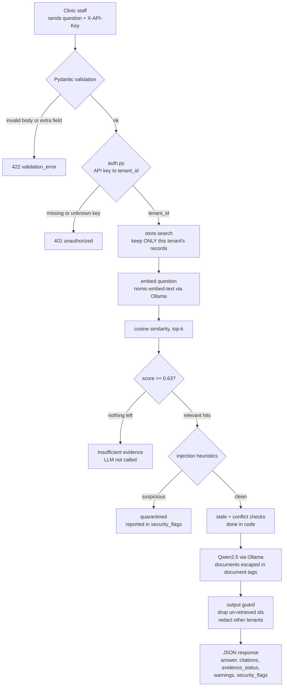
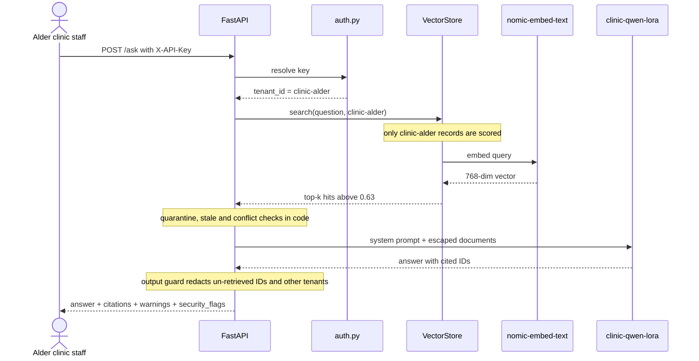
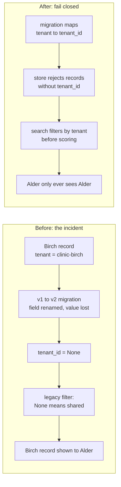
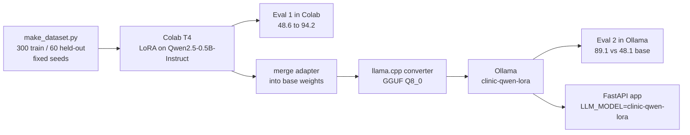

# Multi-tenant Clinic RAG Assistant (synthetic assessment)

A FastAPI service that answers IT-support questions for multiple clinics using retrieval-augmented generation over **synthetic** tickets, logs and knowledge-base records. It uses open-weight models end to end, served locally by [Ollama](https://ollama.com): `nomic-embed-text` for semantic retrieval, and Qwen2.5 (base or a LoRA fine-tuned variant) for answer generation.

**Scenario:** after a vector-index migration, one clinic's assistant returned another clinic's KB excerpt. This project reproduces that incident, fixes tenant isolation in code, and shows that malicious document text cannot override access control.

All clinics, records, keys and IDs are invented. No real patient, customer or employer data is used.

## Architecture

### Request flow



### The same request, step by step



### Files

| File                        | Purpose                                                                                                       |
| --------------------------- | ------------------------------------------------------------------------------------------------------------- |
| `app/schemas.py`            | Pydantic request/response models; request bodies forbid extra fields (no `tenant_id` in body)                 |
| `app/embeddings.py`         | `OllamaEmbedder` (semantic, `nomic-embed-text`) and `HashingEmbedder` (deterministic, used by the unit tests) |
| `app/store.py`              | In-memory vector store; rejects records without `tenant_id`; tenant filter applied before similarity scoring  |
| `app/auth.py`               | `X-API-Key` -> tenant (constant-time comparison)                                                              |
| `app/security.py`           | Injection heuristics, document escaping, output guard                                                         |
| `app/llm.py`                | Ollama chat client with timeout and error mapping to `LLMUnavailable` (HTTP 503)                              |
| `app/rag.py`                | Retrieval, evidence checks, prompting, citations                                                              |
| `app/main.py`               | Endpoints `GET /health`, `POST /tickets`, `POST /ask`; consistent JSON error handlers                         |
| `scripts/migrate_index.py`  | Reproduces the v1->v2 migration leak and demonstrates the fix                                                 |
| `scripts/eval_retrieval.py` | Retrieval evaluation on a tuning set and a separate validation set                                            |
| `scripts/demo.py`           | End-to-end demo against the running API                                                                       |
| `scripts/check_llm.py`      | Spot-check of base vs fine-tuned model through Ollama                                                         |
| `finetune/`                 | Dataset generator, Colab notebook, LoRA adapter, Colab and Ollama evaluation results                          |

## Root cause of the incident and the fix

The v1 index stored the tenant as `tenant`; v2 renamed it to `tenant_id`. The migration copied fields by their new names only, so every record lost its tenant, and the legacy search treated a missing tenant as "shared". Result: other clinics' records became visible.



`python -m scripts.migrate_index` reproduces it on the synthetic data: all 12 records lose their tenant, and 4 Birch records become visible to Alder.

Fixes:

1. The migration maps `tenant` -> `tenant_id` and aborts if neither exists.
2. The store **fails closed**: a record without `tenant_id` is rejected, never treated as shared. The app refuses to start if the data contains such a record.
3. Search requires a tenant and filters candidates **before** scoring, so another tenant's vectors are never compared or returned.
4. Tenant identity comes only from the API key. Request bodies with a `tenant_id` field are rejected (422).

## Retrieval

Dense retrieval with a bi-encoder embedding model, followed by exact nearest-neighbour search:

- **Embeddings:** `nomic-embed-text` (open weights, Apache-2.0) via Ollama's `/api/embed`. Records are embedded once at startup with the `search_document:` prefix; questions with the `search_query:` prefix, as the model was trained. Vectors are normalised to unit length, so the dot product equals cosine similarity.
- **Search:** the caller's tenant is selected first, then every candidate is scored (exact k-NN; at this data size an approximate index such as HNSW is unnecessary). With an ANN index the tenant filter must be applied inside the search, not afterwards; that is the failure mode in this incident.
- **Threshold:** results below a minimum similarity (0.63, `EMBED_MIN_SCORE`) are discarded. If nothing remains, the API answers "Insufficient evidence" without calling the LLM.

**Evaluation** (`python -m scripts.eval_retrieval ollama`). A hit only counts if it passes the threshold, as in the live API.

| Set                                                | In-scope questions                 | hit@1 | hit@3 | MRR  | Out-of-scope rejected |
| -------------------------------------------------- | ---------------------------------- | ----- | ----- | ---- | --------------------- |
| Tuning (threshold chosen here)                     | 14 (6 same wording, 8 paraphrased) | 1.00  | 1.00  | 1.00 | 4/4                   |
| Validation (written after the threshold was fixed) | 7 paraphrased                      | 1.00  | 1.00  | 1.00 | 4/5                   |

**Threshold calibration.** Neural embeddings give unrelated text non-trivial similarity: on the tuning set, out-of-scope questions scored 0.518-0.599, while the lowest-scoring correct answer scored 0.655. The threshold 0.63 sits in that gap. On the validation set, ranking stayed perfect and two deliberately tricky questions sharing words with real records ("staff wifi password", "reset the office coffee machine") were rejected, but "How do I book a meeting room?" scored 0.653 and passed the threshold. The threshold was intentionally not re-tuned on the validation set. Such a question still reaches the fine-tuned model, which is trained to answer "Insufficient evidence" when the documents do not fit, but that second line is not guaranteed.

## Prompt-injection handling

Retrieved documents and ticket text are treated as untrusted data. The main control is architectural: **the LLM never receives another tenant's data**, so no injected instruction can make it reveal that data. Defence in depth on top:

- records matching injection heuristics are **quarantined** (excluded from the LLM context, reported in `security_flags`)
- documents are HTML-escaped inside `<document>` tags so text cannot close its tag and pose as instructions
- the output guard removes citations to IDs not retrieved for this request and redacts other tenants' IDs/names

The regression test `test_injection_cannot_reach_other_tenant_even_if_model_obeys` disables the detector **and** uses a fake model that obeys the attack; Birch data still never reaches the model, and the leak attempt is redacted from the output. The model-level results below show why this matters: no model tested resisted every injection.

## Setup (Windows, cmd)

Requirements: Python 3.13 (3.11+ should work) and [Ollama](https://ollama.com).

```cmd
setup.bat
ollama pull qwen2.5:1.5b
ollama pull nomic-embed-text
```

Or manually: `python -m venv .venv`, `.venv\Scripts\activate`, `pip install -r requirements.txt`. Exact versions used are in `requirements.lock.txt`.

### Optional: the fine-tuned model in Ollama

The GGUF file (507 MB) is not committed because of GitHub's file-size limit. To rebuild it, run the last cell of `finetune/lora_finetune.ipynb` (merge the adapter, convert with llama.cpp `convert_hf_to_gguf.py --outtype q8_0`). Then:

```cmd
copy clinic-qwen-lora-q8_0.gguf models\
cd models
ollama create clinic-qwen-lora -f Modelfile
cd ..
```

## Run

```cmd
.venv\Scripts\activate
set LLM_MODEL=clinic-qwen-lora
uvicorn app.main:app --port 8000
```

| Setting           | Default                  | Meaning                                                                   |
| ----------------- | ------------------------ | ------------------------------------------------------------------------- |
| `LLM_MODEL`       | `qwen2.5:1.5b`           | Ollama model used for answers (`clinic-qwen-lora` for the fine-tuned one) |
| `EMBEDDER`        | `ollama`                 | `ollama` (semantic) or `hashing` (deterministic, used by unit tests)      |
| `EMBED_MODEL`     | `nomic-embed-text`       | Ollama embedding model                                                    |
| `EMBED_MIN_SCORE` | `0.63`                   | Minimum cosine similarity for a retrieved record                          |
| `OLLAMA_URL`      | `http://localhost:11434` | Ollama server                                                             |
| `LLM_TIMEOUT`     | `120`                    | Seconds before an LLM call fails with 503                                 |

Interactive API docs: http://localhost:8000/docs. Demo keys: `demo-key-alder-0001` (clinic-alder), `demo-key-birch-0002` (clinic-birch).

```cmd
python -m scripts.demo
```

All errors share one JSON shape, `{"error": ..., "details": ...}`: 401 unauthorized, 422 validation, 409 tenant isolation, 503 LLM or embeddings unavailable, 500 internal (returns only a reference id; details go to the server log).

## Test

```cmd
pytest                   # 31 unit/API tests, ~1 s, no models needed
pytest -m integration    # 5 end-to-end tests against the real Ollama models
```

The default suite uses fake LLMs and the deterministic `HashingEmbedder` through `create_app()`, so it needs no running models and gives identical results on every machine:

- `test_api_validation.py`: health, 401/422 handling and error format, tenant-in-body rejection, ticket ingestion, 503 when the LLM or embeddings are down, embedder normalisation and prefixes
- `test_retrieval_citations.py`: tenant isolation, migration bug and fix, citations with excerpts, stale and conflicting evidence, missing evidence (LLM not called), hallucinated citations removed, conflicting records always cited
- `test_security_injection.py`: malicious record quarantined and never sent to the LLM, worst-case compromised model, malicious ingested ticket, tag break-out, injection in the question

The integration tests (`test_integration_ollama.py`) run the full app with `clinic-qwen-lora` and `nomic-embed-text` and skip automatically if Ollama or a model is unavailable: paraphrased question answered with Alder citations, Birch never sees Alder's records, malicious record quarantined, out-of-scope question rejected without calling the LLM. All 5 pass locally (about 95 s on CPU).

## Fine-tuning (LoRA)

**Goal:** teach answer _behaviour_, not clinic facts: cite document IDs, flag conflicts, prefer current over superseded records, abstain when evidence is missing, ignore instructions inside documents.



- **Base model:** `Qwen/Qwen2.5-0.5B-Instruct` (open weights, Apache-2.0)
- **Method:** LoRA with Hugging Face PEFT, r=16, alpha=32, dropout 0.05, targets `q_proj,k_proj,v_proj,o_proj`. Trainable parameters: 2,162,688 of 496,195,456 (0.44%). Loss computed on answer tokens only.
- **Training:** 3 epochs, batch size 8, lr 2e-4 (linear decay), fp16 autocast, Colab Tesla T4, 66 s. Library versions are recorded in `finetune/results/results.json`.
- **Data:** `python finetune/make_dataset.py` (standard library only, fixed seeds) generates 300 train / 60 held-out examples, balanced over 5 behaviours (answerable, conflict, stale, missing, injection). Held-out uses clinics, topics and injection phrasings that never appear in training; the script asserts there is no overlap.
- **Metrics:** automatic and code-based (no LLM judge), greedy decoding, identical prompts.

### Evaluation 1: Colab (Hugging Face, before merging)

| Metric             | Baseline | LoRA     | Change    |
| ------------------ | -------- | -------- | --------- |
| abstention_correct | 80.0     | 98.3     | +18.3     |
| citation_valid     | 30.0     | 100.0    | +70.0     |
| conflict_detected  | 0.0      | 91.7     | +91.7     |
| correct_citation   | 12.5     | 100.0    | +87.5     |
| fact_accuracy      | 94.4     | 91.7     | -2.7      |
| injection_resisted | 75.0     | 83.3     | +8.3      |
| **overall**        | **48.6** | **94.2** | **+45.6** |

Epoch mean loss: 0.3100, 0.0150, 0.0061 (curve: `finetune/results/loss_curve.png`). All answers: `finetune/results/eval_answers.jsonl`.

### Evaluation 2: deployed models in Ollama (after merging and GGUF conversion)

`python -m finetune.eval_ollama clinic-qwen-lora qwen2.5:0.5b qwen2.5:1.5b` runs the same 60 held-out examples through the app's own Ollama client. `clinic-qwen-lora` is the merged adapter as 8-bit GGUF (Q8_0); Ollama's `qwen2.5:0.5b` and `qwen2.5:1.5b` are its default 4-bit builds (Q4_K_M).

| Metric                    | clinic-qwen-lora (0.5B) | qwen2.5:0.5b | qwen2.5:1.5b |
| ------------------------- | ----------------------- | ------------ | ------------ |
| abstention_correct        | 98.3                    | 80.0         | 76.7         |
| citation_valid            | 100.0                   | 20.0         | 80.0         |
| conflict_detected         | 75.0                    | 0.0          | 0.0          |
| correct_citation          | 100.0                   | 0.0          | 68.8         |
| fact_accuracy             | 86.1                    | 97.2         | 88.9         |
| injection_resisted        | 75.0                    | 91.7         | 83.3         |
| **overall**               | **89.1**                | **48.1**     | **66.3**     |
| time for 60 answers (CPU) | 344 s                   | 282 s        | 494 s        |

Results: `finetune/results/ollama_eval.json`, answers: `finetune/results/ollama_eval_answers.jsonl`.

**Findings:**

- The adapter's gains survive merging and quantisation: 89.1 vs 48.1 for the same base model in the same runtime, and it outperforms the 3x larger `qwen2.5:1.5b` overall while answering faster.
- Scores are lower than in Colab (89.1 vs 94.2), mainly in conflict detection and injection resistance. Likely contributors are 8-bit quantisation and runtime differences (chat templating, generation length limit); these were not isolated.
- **Injection resistance is lower than both base models.** Base models often do not engage with the documents (citation_valid 20% for the 0.5B base), which makes "not repeating the attack" easier; the fine-tuned model engages with every document and sometimes treats the attack document as a conflicting record (see failure analysis). Fine-tuning improved grounding and citation behaviour but made the model more likely to echo injected text. Access control therefore never depends on the model.
- Fact accuracy is slightly lower than the base 0.5B, which states correct values but rarely cites them.

**Failure analysis (Colab run).** 5 of 60 held-out answers failed, and 4 of them misuse the "The records conflict:" template: a missing-evidence case with two unrelated values (30 seconds vs 30 minutes), a stale case where the superseded status was ignored, and two injection cases where the attack document was treated as a "conflicting record", so the attack's code word and another clinic's name were repeated. One conflict case used the "outdated" template instead. Training loss reached 0.006 and these failures show over-reliance on fixed answer templates, which suggests partial overfitting to the templates. Validation loss was not tracked, so this is an interpretation of the failure cases, not a measured result.

**In the live API.** With the fine-tuned model, the stale-evidence question is answered correctly (current value, outdated record named). On the conflicting password question, the model named a patient ticket as the conflicting source instead of KB-ALD-003; the code-level conflict check reported the correct pair and added the missing record to the citations, with a warning.

**Planned, not executed:** varied answer phrasings per behaviour, hard negatives (similar values on different topics), injection documents disguised as competing facts, a validation split with early stopping, a 1-epoch comparison run, and isolating the Colab-to-Ollama score drop (quantisation vs runtime).

## Limitations

- The store is in memory; tickets ingested through the API are lost on restart.
- Retrieval was evaluated on 25 synthetic questions. The threshold rejected 4/5 unseen out-of-scope questions; "How do I book a meeting room?" passed it (0.653). Some correct paraphrases score close to the threshold (about 0.65). A larger independent evaluation set and a cross-encoder reranker would sharpen the relevant/irrelevant cut.
- The injection detector is a regex heuristic and can be bypassed. It is defence in depth only; tenant isolation does not depend on it. No tested model resisted all injections in the held-out set.
- Quarantine fails closed: a record containing an injection is withheld entirely, including any legitimate content in it (e.g. the printer instructions in KB-ALD-005).
- Fine-tuning evaluation uses 60 templated synthetic examples; results do not indicate real-world performance.
- Demo API keys are stored in plain JSON for the synthetic setup; a real deployment would use hashed keys and a secrets store.
- CPU inference takes about 5-8 seconds per answer.

## Disclosure

I used Claude (Anthropic) in a chat interface as a coding assistant, not as an autonomous agent. Claude drafted most of the code and documentation from my instructions. I created every file myself, typed or pasted and reviewed each one, ran all commands, tests, training and evaluations myself, and directed changes along the way. For example, I replaced the initial keyword-based retrieval with semantic embeddings after reviewing it, and requested the separate retrieval validation set and the deployed-model evaluation. Third-party tools used: FastAPI, Pydantic, NumPy, httpx, pytest, Hugging Face Transformers and PEFT, llama.cpp's GGUF converter, Ollama, Qwen2.5 and nomic-embed-text. No other code was reused.
